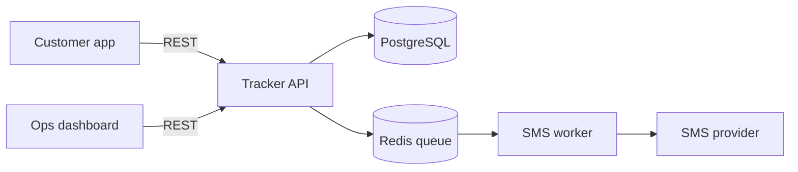

# Code Reviews and Documentation

> [!GOALS]
> - Explain why teams review code, and what reviews really achieve — not only catching bugs, but spreading knowledge and keeping a codebase consistent.
> - Prepare a pull request that is easy to review, and respond to feedback professionally.
> - Review someone else's code in a sensible order: correctness, tests, security, performance, design, readability — leaving style to tools.
> - Write review comments that are specific, kind and clearly marked as blocking or optional.
> - Recognise review anti-patterns: rubber-stamping, nitpicking, gatekeeping and review queues that block the team.
> - Choose the right kind of documentation for each need: README, tutorial, how-to guide, reference, explanation, runbook.
> - Record important technical decisions in **Architecture Decision Records** and larger proposals in **design documents**.
> - Keep documentation alive by treating it like code: in the repository, reviewed, and updated with every change.

## Why this matters

In {{ch:github}} you learned the mechanics of a pull request: branch, push, open, review, merge. But the mechanics are the easy part. What happens **inside** the review decides whether it is worth anything.

Consider two teams. In the first, a developer opens a 2,000-line pull request on Friday afternoon with the description "updates". A reviewer, busy with their own work, scrolls through it, sees nothing obviously wrong, and clicks *Approve*. On Monday, production is down: the change silently removed a permission check. In the second team, the same feature arrives as five small pull requests, each with a clear description. Reviewers look at each within a few hours. One reviewer notices that a new endpoint is missing an authorisation check and asks about it; the author adds the check and a test. Another reviewer learns, from reading the code, how the new pricing module works — and next month fixes a bug in it without help.

Same people, same skills. The difference is **how they review**.

Documentation has the same story. A new developer joins. In one team, they spend two weeks asking colleagues how to run the project, why the system uses two databases, and what to do when the nightly import fails. In another, a README gets them running in an hour, a short set of decision records explains the two databases, and a runbook walks them through the failed import. Knowledge that lives only in people's heads leaves when they leave, and every new person costs everyone else time.

Code review and documentation are both about **communication**: making sure that what one person knows, the team knows. They are skills you will be judged on from your first week in a job — and good reviewers and writers are noticed quickly.

## The simple idea

Think of a newspaper. A reporter writes a story; an **editor** reads it before it is printed. The editor checks the facts, asks "is this fair?", spots unclear sentences, and makes sure it matches the paper's style. The editor is not the reporter's enemy; both want the best possible story, and the reporter learns from every edit. Over time, everyone at the paper writes in a consistent voice, because they all read and edit each other's work.

**Code review** is that editorial process for software. **Documentation** is the newspaper's archive and style guide: the place where anyone can look up what happened, why, and how things are done.

> [!ANALOGY]
> A code review is like a newspaper editor reading a story before print: checking facts, clarity and fit, so the published result is better and the writer learns.
>
> **Where the analogy breaks:** a newspaper editor usually outranks the reporter and has the final word. In code review, the reviewer is normally a **peer** — sometimes more junior than the author — and the review is a conversation between equals. A junior developer reviewing a senior's code is not only allowed but valuable: they learn, and their questions often expose assumptions the senior did not notice.

## The proper definition and key words

**Code review** is the practice of having one or more developers, other than the author, examine a change to source code before it is integrated, to improve its quality and share knowledge.

**Technical documentation** is written material that explains a software system to the people who build, run or use it.

The key words:

- **Author** — the developer who wrote the change.
- **Reviewer** — a developer who examines the change and gives feedback.
- **Approval** — a reviewer's statement that the change may be merged.
- **Blocking comment** — feedback that must be addressed before merging.
- **Non-blocking comment** (often called a **nit**, from "nitpick") — an optional suggestion the author may accept or decline.
- **Self-review** — the author reading their own change as a reviewer would, before asking others.
- **Architecture Decision Record (ADR)** — a short document recording one significant technical decision: the situation, the choice and its consequences.
- **Design document** (sometimes called an **RFC**, "request for comments") — a longer proposal for a significant piece of work, written and discussed **before** building it.
- **Runbook** — step-by-step instructions for operating a system: deploying, rolling back, handling a specific alert.
- **Docs as code** — keeping documentation in the repository, in plain text, reviewed and versioned like code.

## How it works inside: what reviews actually achieve

It is natural to assume that the main purpose of code review is finding bugs. Reviews do find bugs — but research on how real teams review suggests that is not even the biggest benefit. A widely cited study of code review at Microsoft (by Alberto Bacchelli and Christian Bird, published in 2013) found that while developers *expected* reviews mainly to find defects, much of what reviews actually produced was **knowledge transfer, better team awareness of changes, and improvements to code clarity and maintainability**.

So a review does several jobs at once:

```text
                        ┌──────────────────────────────┐
     a change ─────────▶│         code review          │
                        └──────────────┬───────────────┘
            ┌──────────────┬───────────┼────────────┬───────────────┐
            ▼              ▼           ▼            ▼               ▼
      catches bugs   spreads      keeps the     improves       creates a
      and security   knowledge    codebase      readability    record of why
      problems       (two people  consistent    for the next   (discussion
                     know it)                   reader         stays with PR)
```

- **Defects and risks** — logic errors, missing edge cases, security holes, performance traps.
- **Knowledge sharing** — after a review, at least two people understand the change. This reduces the **bus factor**: the number of people who would have to disappear before nobody understands a part of the system. A bus factor of one is a serious risk.
- **Consistency** — reviewers notice when a change solves a problem differently from the rest of the codebase.
- **Readability** — if a reviewer cannot understand the code, the next maintainer will not either. Confusion during review is a **finding**, not a failure of the reviewer.
- **History** — the PR discussion records why decisions were made, linked from `git blame` forever ({{ch:git}}).

Understanding this changes how you review. A review that finds no bugs is not wasted. And a reviewer who asks "why does this work?" is doing the job well.

## Before review: preparing a change

Most of what makes a review good happens **before** the reviewer sees it. As the author, your job is to make the reviewer's job easy.

### Keep it small and focused

Review quality drops sharply as changes grow. A reviewer can examine a 150-line change carefully. Faced with 2,000 lines, people skim. Google's public engineering guidelines on code review recommend small changes for exactly this reason, and many teams use a rough guide of a few hundred changed lines at most.

Equally important: **one logical change per pull request**. Do not mix a refactoring, a bug fix and a new feature. If you notice something to clean up while building a feature, put the clean-up in a separate PR — ideally merged first, so the feature PR stays small.

### Review it yourself first

Before requesting a review, read your own diff on GitHub, file by file, as if someone else wrote it. You will find a surprising amount: a forgotten `console.log`, a debugging change, a commented-out block, a test you meant to write, a confusing name. Every problem you find yourself saves a review round-trip and a little of your reviewer's patience.

### Make sure the basics pass

Tests, linting and type-checking should pass before you ask a human to look ({{ch:testing}}). Reviewers' time is the most expensive resource in the process; do not spend it on things a machine can check.

### Write a description that guides the reviewer

You saw the what / why / how / testing / risks template in {{ch:github}}. Two additions make reviews much faster:

- **Point to the important parts.** "The core change is in `pricing.ts`; the other files are renames." Reviewers then spend their attention where it matters.
- **Say what feedback you want.** "I'm unsure about the caching approach in `catalogue-service.ts` — is there a simpler way?" invites the review you need.
- For user-interface changes, add **screenshots** or a short screen recording, before and after.

### Annotate your own pull request

You can comment on your own PR's lines before reviewers arrive: "This looks odd, but the provider requires amounts as strings — see their docs." This answers questions before they are asked. (If the explanation is useful to future readers, put it in a code comment instead, so it is not lost after merging.)

## Reviewing a change

### Level 3 — A reading order

Start with the **description**: what is this change meant to do, and why? You cannot judge whether code is correct without knowing what it is supposed to do.

Then look at the change in an order that catches the most important problems first. A sensible priority:

1. **Correctness.** Does it do what the description says? What happens with empty input, zero, very large values, concurrent requests, a failed network call? Does it handle errors? ({{ch:clean-code}})
2. **Tests.** Are the important behaviours tested — including boundaries and failure paths? Would the tests fail if the code were wrong? ({{ch:testing}})
3. **Security.** Is every input validated? Are permissions checked? Could user input reach a database query, a file path or a shell command unsafely? Are secrets kept out? ({{ch:application-security}})
4. **Performance and operations.** Is there a database query inside a loop? Unbounded growth of a list or cache? Missing indexes for new queries? Will it log enough to debug a production problem — and not log personal data? ({{ch:logging}})
5. **Design.** Is this the right place for this code? Is it more complex than it needs to be? Does it duplicate something that exists? Will it be easy to change? ({{ch:solid-principles}})
6. **Readability.** Can you understand it? Are names clear? Would a comment explain a non-obvious "why"?
7. **Consistency and style.** Does it follow the codebase's conventions? (Formatting itself should be handled entirely by tools — {{ch:clean-code}}.)

You do not need to find everything. The goal, in the words of Google's code-review guidelines, is that a change should be approved once it **definitely improves the overall health of the code**, even if it is not perfect. Perfection is not the standard; "better than before, and safe" is.

### Level 3 — A worked review

Here is a small change to an online shop. The description says: *"Add pagination to the order history endpoint: `GET /orders?page=N` returns 20 orders per page, newest first."*

```ts
// fragment
// src/orders/order-history.ts
const PAGE_SIZE = 20;

export async function orderHistory(db: Db, req: Request) {
  const page = Number(req.query.page);
  const offset = page * PAGE_SIZE;
  const orders = await db.query(
    `SELECT * FROM orders WHERE customer_id = ${req.user.id}
     ORDER BY created_at DESC LIMIT ${PAGE_SIZE} OFFSET ${offset}`,
  );
  return orders;
}
```

Reading it carefully, in our order:

- **Correctness.** If pages are numbered from 1 (as users expect), page 1 should skip zero orders, but `offset = page * PAGE_SIZE` skips 20. The first page of orders can never be seen. And if `page` is missing, `Number(undefined)` is `NaN`, so the offset is `NaN` — the query will fail.
- **Tests.** There are none. Pagination is boundary-heavy; it needs tests for page 1, the last partial page, an empty page and invalid input.
- **Security.** The SQL is built by inserting values into a string. `req.user.id` is probably safe, but the pattern is dangerous: if anyone later inserts user-controlled input this way, it becomes **SQL injection**, one of the most damaging vulnerabilities ({{ch:application-security}}). Use a **parameterised query**, where values are sent separately from the SQL text ({{ch:sql}}).
- **Performance.** `SELECT *` returns every column, including possibly large ones. `OFFSET` pagination slows down on deep pages, and there should be an index on `(customer_id, created_at)` ({{ch:indexes}}). For order history that is acceptable for now, but worth a note.

Here is the check of the off-by-one claim, as runnable code:

```ts
const PAGE_SIZE = 20;
const offsetAsWritten = (page: number) => page * PAGE_SIZE;
const offsetCorrect = (page: number) => (page - 1) * PAGE_SIZE;

for (const page of [1, 2]) {
  console.log(`page ${page}: written skips ${offsetAsWritten(page)}, should skip ${offsetCorrect(page)}`);
}
console.log(Number(undefined) * PAGE_SIZE);
```

**Output:**

```text
page 1: written skips 20, should skip 0
page 2: written skips 40, should skip 20
NaN
```

Now the comments. Notice how each one is specific, explains why, suggests a fix, and is labelled:

> **issue (blocking):** Pages start at 1 for users, but `offset = page * PAGE_SIZE` skips the first 20 orders on page 1. Should this be `(page - 1) * PAGE_SIZE`? A test for page 1 would catch it.

> **issue (blocking):** If `page` is missing or not a number, `Number(...)` gives `NaN` and the query fails with a 500. Could we default to 1 and reject values below 1 (or non-integers) with a 400? ({{ch:validation}})

> **issue (blocking, security):** Please use a parameterised query (`... WHERE customer_id = $1 ... LIMIT $2 OFFSET $3`) instead of building the SQL string. The values here look safe today, but this pattern is how SQL injection gets in later.

> **suggestion (non-blocking):** `SELECT *` returns the full order rows. The history page only shows id, date, status and total — selecting just those would make the response smaller.

> **question:** Do we have an index on `(customer_id, created_at)`? If not, this query will scan all of a customer's orders on every page.

> **praise:** Nice that `PAGE_SIZE` is a named constant — easy to find and change.

Three blocking issues, one optional suggestion, one question, one genuine compliment. The author knows exactly what must change, what is optional, and why.

### Level 4 — Writing comments that work

**Be specific.** "This is confusing" gives the author nothing to act on. "I had to read `calc` three times — would `deliveryFeePaisa` describe it?" does.

**Explain why.** "Use a `Map` here" sounds like a preference. "This `find` inside the loop makes it O(n²), which matters for carts with many items; a `Map` lookup would keep it O(n)" teaches something and can be discussed on its merits ({{ch:big-o}}).

**Label the weight of each comment.** Authors cannot read your mind. Is "maybe rename this?" a demand or an idea? A widely used convention, **Conventional Comments**, puts a label at the start of each comment:

| Label | Meaning |
|---|---|
| `praise:` | Something done well — say it when it is true |
| `issue:` | A problem that needs addressing (say whether it blocks merging) |
| `suggestion:` | A proposed improvement, with the reason |
| `question:` | You need to understand something; not necessarily a change |
| `nitpick:` (or `nit:`) | A tiny, optional point of preference |
| `thought:` | An idea for the future, not for this PR |

Some teams use simpler tags such as `[blocking]` and `[nit]`. The tag matters less than having **some** agreed way to separate "must" from "might".

**Talk about the code, not the person.** Compare:

- "You didn't handle the empty case." → "What happens here when the cart is empty?"
- "Why would you do it this way?" → "What led to this approach? I wondered whether X would be simpler because Y."
- "This is wrong." → "I think this returns the wrong total when a coupon and a gift card are combined — here's the case I tried."

Questions invite explanation — and sometimes **you** are the one who is wrong, because the author knows something you do not. Asking first protects both of you.

**Offer to talk.** If a thread goes back and forth three times, stop typing and have a short call. Then write a summary of what you agreed in the PR, for the record.

**Approve with comments when appropriate.** If the only remaining points are nits, approve and let the author decide. Blocking a merge for a preference wastes everyone's time.

### Level 4 — Receiving feedback

Feedback on your code is not a judgement of you. It is the cheapest learning you will ever get: a colleague spending their time to make your work better.

- **Respond to every comment.** "Done in a3f9e1c", "Good catch, fixed and added a test", or a reasoned disagreement. Never ignore a comment silently.
- **Disagree with reasons, and be open to being wrong.** "I kept the loop because the list is at most 5 items and the loop is clearer; happy to change if you feel strongly." If you cannot agree, involve a third person or follow the team's convention, rather than arguing endlessly.
- **Do not take it personally — and do not make it personal.** Assume good intent in comments that are worded badly.
- **Thank people.** Especially for catching real problems.
- **Learn patterns.** If reviewers keep pointing out the same kind of issue, add it to your self-review checklist.

### Level 5 — Timing and flow

An unreviewed pull request **blocks** its author: they either wait or start something new and pile up half-finished work. Many teams agree on a target such as "first response within one working day", and many experienced engineers make reviewing their **first** task when they return from a break, before writing new code. If you cannot review in time, say so, so the author can ask someone else.

Large reviews can be split across sessions. Reviewing for more than about an hour at a time reduces how much you notice; it is better to stop and come back.

## Review anti-patterns

| Anti-pattern | What it looks like | Why it hurts | Better |
|---|---|---|---|
| **Rubber-stamping** | Approving within a minute without really reading | Gives a false sense of safety | Review properly, or say you cannot |
| **Nitpicking** | Dozens of comments on spacing and personal taste | Buries real issues, wastes time, demoralises | Automate style; label nits; focus on substance |
| **Gatekeeping** | Blocking until the code is written exactly the reviewer's way | Slows the team; authors stop taking initiative | Block only for real problems; accept different-but-fine |
| **Moving the goalposts** | New demands in every round | Endless review cycles | Give all feedback in one pass where possible |
| **Drive-by redesign** | "Have you considered rewriting this as microservices?" on a bug fix | Out of scope for the PR | Raise big ideas separately, as a `thought:` or an issue |
| **Review queue** | PRs waiting days for anyone to look | Blocks work; encourages giant PRs | Agreed response times; shared responsibility |
| **The silent author** | Comments ignored or "fixed" without reply | Reviewers lose trust | Respond to every comment |
| **Large unreviewable PRs** | 3,000-line changes | Nobody can review them well | Split into small, safe steps |

## Documentation

### Level 1 — Why code is not enough

"Good code documents itself" is partly true: clear names and small functions explain **what** the code does ({{ch:clean-code}}). But code cannot explain:

- **Why** the system is designed this way, and what alternatives were rejected.
- **How** to set it up, run it, deploy it or recover it when it breaks.
- **What** the system is for, who uses it, and how its parts fit together.
- **How to use it** from outside — for example, the contract of an API used by another team.

That knowledge must be written down, or it is lost whenever someone leaves, and recreated at great cost.

### Level 2 — Four kinds of documentation

A useful way to organise documentation is the **Diátaxis** framework (by Daniele Procida), which separates four kinds of writing, each serving a different need:

```text
                   learning                     working
               ┌───────────────────────┬───────────────────────┐
   practical   │ TUTORIALS             │ HOW-TO GUIDES         │
   (doing)     │ "Build your first     │ "How to add a new     │
               │  feature with us"     │  payment provider"    │
               ├───────────────────────┼───────────────────────┤
   theoretical │ EXPLANATION           │ REFERENCE             │
   (knowing)   │ "Why orders use event │ "API endpoints,       │
               │  sourcing"            │  config options"      │
               └───────────────────────┴───────────────────────┘
```

- **Tutorials** teach a newcomer by walking them through a complete small task. Example: an onboarding guide that has a new developer set up the project and ship a tiny change.
- **How-to guides** solve a specific problem for someone who already knows the basics. Example: "How to rotate the payment API key".
- **Reference** describes the system precisely and completely — API endpoints, configuration variables, database tables. It is looked up, not read from start to finish, and is often partly generated (for example, API documentation generated from an OpenAPI specification — {{ch:api-documentation}}).
- **Explanation** discusses background and reasoning — architecture overviews, design decisions, trade-offs.

The most common documentation failure is **mixing** them: a "README" that is half tutorial, half reference and half history, which serves nobody well. When you write, first decide which of the four you are writing.

### Level 3 — The README

Every repository needs a README — the front door ({{ch:github}}). For an application, a good README covers:

```text
# Delivery Tracker

Tracks parcels from warehouse to doorstep and sends customers SMS updates.
Used by the operations team and the customer app.

## Quick start
    git clone git@github.com:corner-shop/delivery-tracker.git
    cd delivery-tracker
    npm install
    cp .env.example .env      # see "Configuration" below
    docker compose up -d      # starts PostgreSQL and Redis
    npm run migrate
    npm run dev               # http://localhost:4000

## Configuration
| Variable       | Purpose                          | Required | Example                        |
|----------------|----------------------------------|----------|--------------------------------|
| DATABASE_URL   | PostgreSQL connection string     | yes      | postgres://localhost/tracker   |
| REDIS_URL      | Redis for job queues             | yes      | redis://localhost:6379         |
| SMS_API_KEY    | SMS provider key (test key ok)   | yes      | (ask in #delivery-team)        |

## Tests
    npm test                  # unit tests, no services needed
    npm run test:integration  # needs docker compose running

## Architecture
See docs/architecture.md and the decision records in docs/adr/.

## Deployment
Merges to main deploy to staging automatically; production needs approval
in the GitHub "production" environment. See docs/runbooks/deploy.md.

## Who to ask
#delivery-team on chat. Code owners are listed in .github/CODEOWNERS.
```

The test of a README: **can a new developer get the project running without asking anyone?** Ask the next new joiner to try, and fix every place they get stuck. Their confusion is your documentation's bug report.

### Level 4 — Architecture documentation and diagrams

For anything bigger than a small service, write a short **architecture overview**: the main components, how data flows between them, and which external systems are involved. A diagram is worth the effort here.

Simon Brown's **C4 model** is a popular way to draw software architecture at four levels of zoom: **Context** (the system and the people and systems around it), **Containers** (the deployable parts: web app, API, database, queue), **Components** (the major parts inside one container), and **Code** (rarely drawn). Most teams need only the first two.

Diagrams in documentation rot quickly when they are images edited in a separate drawing tool. **Diagrams as code** solve this: tools such as **Mermaid** let you describe a diagram in text that lives in the repository and is reviewed like code, and GitHub renders Mermaid diagrams inside Markdown automatically:

````text

````

### Level 4 — Architecture Decision Records

Months after a decision, people ask: "Why do we use Redis for the queue instead of the database?", "Why did we choose MongoDB here?". If the answer exists only in the memory of someone who has left, the team either repeats a long debate or, worse, reverses a good decision without knowing why it was made.

An **Architecture Decision Record (ADR)** captures one significant decision in a short document. The format most teams use comes from Michael Nygard, who proposed it in 2011:

```text
# ADR 0007: Use PostgreSQL with pgvector for product search

Status: Accepted
Date: 2026-03-15
Deciders: delivery and search teams

## Context
Customers need search that understands meaning ("warm winter jacket"
should find "fleece coat"). This needs vector similarity search over
about 500,000 products. We already run PostgreSQL; the team knows SQL
well; search volume is under 1,000 queries per minute.

## Decision
Use the pgvector extension in our existing PostgreSQL database.

## Consequences
+ No new infrastructure to operate or pay for.
+ Search results can be joined and filtered with existing product data in SQL.
- Dedicated vector databases scale further; we will revisit if we pass
  about 5 million vectors or 5,000 queries per minute.
- Heavy search load now shares a database with orders; we will monitor it.

## Alternatives considered
- A managed vector database service: excellent performance, but a new
  vendor, new costs and data duplication.
- A self-hosted vector database: good performance, but we would have to
  operate it ourselves.
```

The rules that make ADRs useful:

- **One decision per record**, short — usually one page.
- **Numbered and stored in the repository**, for example `docs/adr/0007-pgvector-for-search.md`, so they are reviewed in pull requests and live next to the code they explain.
- **Write the context honestly**, including constraints (team skills, budget, time) — a decision that looks wrong out of context often looks right with it.
- **Record the downsides and when to revisit.** A good ADR says what would make the decision wrong in the future.
- **Never delete or rewrite old ADRs.** When a decision changes, write a new ADR and mark the old one "Superseded by ADR 0012". The history of reasoning is the point.

When should you write one? A good test: *will a new engineer reasonably ask "why did we do it this way?" in six months?* Choosing a database, framework, messaging approach, authentication method or deployment platform — yes. Naming a variable or fixing a bug — no.

You will see ADRs again — the pgvector example above relates to {{ch:embeddings-and-vector-databases}}, and {{ch:engineering-decisions}} discusses decision-making in depth.

### Level 5 — Design documents

An ADR records a decision. A **design document** (or RFC) is written **before** building something significant, to think it through and gather feedback while changes are still cheap. Teams typically write one when work will take more than a few weeks, affects several teams, or carries real risk.

A common outline:

1. **Summary** — one paragraph.
2. **Background and problem** — why this matters now; who is affected.
3. **Goals and non-goals** — what this will and, explicitly, will **not** do. Non-goals prevent scope creep.
4. **Proposed design** — components, data model, APIs, diagrams.
5. **Alternatives considered** — and why they were rejected.
6. **Risks, security and privacy** — what could go wrong; how it is mitigated.
7. **Rollout and migration** — how it ships safely; how to roll back.
8. **Open questions.**

The value is in the **discussion** it enables: reviewers can find a fatal flaw in a two-page document in an hour, instead of in a finished implementation after two months. Many large technology companies have publicly described design-doc cultures of this kind. You will practise presenting designs in {{ch:presenting-a-design}}.

### Level 5 — Runbooks

A **runbook** tells an engineer — possibly one who has never touched the system, woken at 3 a.m. by an alert — exactly what to do in a specific situation:

```text
# Runbook: SMS queue backlog alert

Alert: "sms_queue_depth > 5000 for 10 minutes"
Impact: customers receive delivery updates late. Orders are NOT affected.

1. Check the provider status page (link). If they report an outage,
   post in #delivery-incidents and wait; messages will be retried.
2. Check worker health: dashboard "SMS workers" (link).
   - If workers are down: restart them — see deploy.md#restart-workers.
   - If workers are up but slow: check error rate panel. If errors are
     mostly HTTP 429 (rate limited), reduce concurrency:
       set SMS_WORKER_CONCURRENCY=5 in production config, then restart.
3. If the backlog is not falling after 30 minutes, page the delivery
   team on-call (escalation policy link).

Last tested: during the March game-day exercise.
```

Good runbooks are specific (exact commands and links), start with impact (how bad is this?), and are **tested** — ideally by someone other than the author — because untested instructions often fail exactly when needed. They connect directly to alerts and incident handling ({{ch:observability-and-incidents}}).

### Other documentation you will meet

- **API documentation** — for services other teams or customers call; usually generated from an OpenAPI specification ({{ch:api-documentation}}).
- **Changelog** — a human-readable list of notable changes per release, grouped as Added, Changed, Fixed, Removed (a format popularised by the "Keep a Changelog" project). Often drafted automatically from PR titles ({{ch:github}}).
- **Onboarding guide** — a tutorial for new team members: accounts to request, the first small task, who to ask.
- **Code comments and doc comments** — for non-obvious reasons in the code itself ({{ch:clean-code}}).
- **Postmortems** — written after incidents, explaining what happened and what will change ({{ch:observability-and-incidents}}).

## Keeping documentation alive

Out-of-date documentation is worse than none: it confidently misleads. A README with the wrong setup commands costs a new joiner a day; an architecture page describing a system that no longer exists causes wrong decisions. Practices that keep documentation true:

- **Docs as code.** Keep documentation in the repository as Markdown, next to what it describes. It is versioned with the code, reviewed in the same PRs, and searchable.
- **Update docs in the same pull request as the change.** Add "Documentation updated?" to the PR template, and treat a missing update as a review comment like any other.
- **Prefer generated reference.** API reference generated from the code or specification cannot drift as easily as hand-written lists.
- **Date and own important documents.** A "last reviewed" line and an owner make stale documents visible.
- **Delete what is wrong.** Removing an obsolete page is a valuable change.
- **Test instructions.** Run the README's quick start in a fresh environment occasionally — or automatically, in CI.

## From beginner to enterprise

**Level 3 — your own projects.** Self-review every PR; write clear descriptions; give every project a README a stranger could follow.

**Level 4 — a team.** Small PRs; one or two reviewers; agreed comment labels; a response-time expectation; PR templates with a documentation checkbox; ADRs for significant decisions; runbooks for the alerts you have.

**Level 5 — professional practice.** Style and formatting fully automated, so reviews focus on substance; CODEOWNERS for sensitive areas ({{ch:github}}); design documents for large work; regular "docs days" or clean-up as part of normal work; new joiners asked to improve onboarding docs as their first task.

**Level 6 — large organisations.** Reviews at this scale rely on tooling: automated checks and code-analysis bots comment before humans do; ownership rules route changes to the right experts across hundreds of teams. Design reviews for cross-team systems become formal processes with architecture review groups. Internal developer portals collect service catalogues, ownership, runbooks and API documentation in one searchable place. Some organisations, as Google has described publicly, also certify engineers in a language's style ("readability") before they can approve code in that language — a way of keeping consistency across a very large codebase.

## Real-world use cases

### Spreading knowledge of a critical module

- **Problem:** only one engineer understands the billing module; when they are away, billing changes stop.
- **Approach:** require a second reviewer from outside the billing "owner" for every billing PR, deliberately rotating reviewers; ask reviewers to explain the change back in their review summary; write an explanation document and two ADRs for the module's main decisions.
- **Result:** within a few months, three engineers can work on billing. The original expert's reviews become faster, not slower, because others now catch issues too.

### Review delays slowing the team

- **Problem:** PRs wait two days for review; developers start building on unmerged work; merges become painful.
- **Approach:** agree on a first response within one working day; make reviewing the first task of each morning; limit PR size; a daily check of the open-PR list during the team's stand-up ({{ch:agile-and-scrum}}).
- **Result:** shorter waits, smaller PRs, fewer conflicts.

### Repeated debates about the same decision

- **Problem:** every new senior hire asks why the system uses MongoDB for orders, and a long discussion follows.
- **Approach:** write the missing ADR, honestly including what the team now regrets and the conditions under which they would migrate.
- **Result:** the next new hire reads it in five minutes; discussions start from shared facts.

## Common mistakes

### Beginner: asking for review before self-reviewing

Debug prints, commented-out code and a missing test, all spotted by the reviewer. **Fix:** read your diff on GitHub first, every time.

### Beginner: "LGTM" without reading

"Looks good to me" in thirty seconds on a 500-line change. **Consequence:** false confidence; real bugs and security holes merged. **Fix:** review properly or decline; if you only checked one part, say so ("Reviewed the API changes; did not look at the migration").

### Beginner: taking feedback personally

Defensive replies, or silently ignoring comments. **Fix:** treat feedback as help; respond to each comment; disagree with reasons.

### Intermediate: commenting only on style

Twenty comments on naming and spacing, nothing on the missing permission check. **Fix:** follow the priority order — correctness, tests, security first; let formatters handle style.

### Intermediate: unlabelled comments

The author cannot tell which comments block the merge, so they either change everything (slow) or nothing (risky). **Fix:** label comments as blocking or optional.

### Production: documentation that is wrong

A runbook referring to commands that no longer exist, discovered during an outage. **Fix:** update docs in the same PR as the change; test runbooks; mark owners and review dates.

### Enterprise: decisions with no record

Large architectural choices made in meetings or chat, then forgotten. **Fix:** an ADR for every significant decision, linked from the PR that implements it.

## Debugging and troubleshooting

**Reviews take forever.** Measure first: how long do PRs wait for a first response, and how big are they? Usually the causes are large PRs, unclear ownership of reviewing, and reviewing treated as an interruption rather than as part of the job.

**The same bugs keep reaching production despite reviews.** Look at what reviewers are actually commenting on. If it is mostly style, automate style and agree on a checklist for the risky areas (validation, permissions, error handling). Add tests for the class of bug; reviews are not a substitute for tests.

**Review threads become arguments.** Move to a call after two back-and-forths; agree on team conventions for recurring disagreements and write them down (in a style guide or an ADR) so the debate happens once.

**Nobody reads the documentation.** Check whether it is findable (linked from the README), current, and the right kind — people looking for a how-to guide will not read a long explanation. Watch a new joiner use it.

## Security and performance

**Security.** Code review is one of the main defences against security bugs and against **malicious changes** — a compromised account, or an insider. That is why sensitive areas should require review by people who understand them (CODEOWNERS), why approvals should be dismissed after new commits, and why nobody should be able to merge their own unreviewed change. Reviewers should pay special attention to authentication and authorisation changes, input handling, new dependencies, configuration and infrastructure files, and anything touching secrets. Documentation must not contain secrets either: no real keys in READMEs or runbooks — point to the secret store instead ({{ch:secrets-manager}}).

**Performance.** In review, look for the common performance traps: database queries inside loops (the "N+1 query" problem — {{ch:query-optimization}}), loading entire tables into memory, missing indexes for new queries, and unbounded caches or lists. Ask for measurements when a change claims to improve performance.

## How a senior engineer thinks about this

- **Reviews are a team responsibility, not a favour.** Reviewing others' work is part of delivering, and fast, thorough reviews make the whole team faster.
- **Ask, don't tell** — especially when reviewing someone less experienced. A question that lets them find the problem teaches more than a correction.
- **Pick battles.** They block for correctness, security and real design problems, and let preferences go.
- **Model good behaviour.** They write small PRs with clear descriptions, respond graciously to feedback from juniors, and say "good catch" when they are wrong.
- **Write it down once.** When the same question comes up twice, they answer it in documentation or an ADR, not in a third chat message.
- **Documentation is part of done.** A feature without updated docs, runbooks or decisions recorded is not finished.

## Exercises

### Exercise 1 — Rewrite the comments

**Objective:** practise writing specific, kind, labelled feedback.
**What to do:** rewrite each review comment so it is specific, explains why, suggests a way forward, and is labelled.

1. "This is wrong."
2. "Why didn't you write tests??"
3. "Bad name."
4. "I would never use a class here."
5. "This could be slow."

<details>
<summary>Show the solution</summary>

1. **issue (blocking):** "When the cart has a gift card worth more than the total, this returns a negative amount — I tried a Rs 500 cart with a Rs 1,000 card and got −500. Should we clamp at zero?"
2. **issue (blocking):** "I couldn't find tests for the new coupon rules. Could we add cases for the minimum order boundary and an expired coupon? Those are the cases most likely to regress."
3. **suggestion (non-blocking):** "`data2` made me look up what it holds. Would `pendingRefunds` describe it?"
4. **thought:** "A plain function might be simpler here, since the class has no state — but it's consistent with the other handlers in this folder, so fine either way."
5. **question:** "This runs a query per order line. For a typical order (2–5 lines) that's fine, but bulk orders can have 200 lines. Could we fetch all the products in one query with `WHERE id = ANY($1)`?"

**Walkthrough:** each version points to the exact problem, explains the consequence, proposes a direction, and makes the weight clear. Notice 4: on reflection, the comment is a preference, so it becomes an optional thought — or is not sent at all.

</details>

### Exercise 2 — Review this change

**Objective:** practise a full review in priority order.
**The change:** description: *"Let admins delete products."*

```ts
// fragment
app.delete("/products/:id", async (req, res) => {
  await db.query(`DELETE FROM products WHERE id = '${req.params.id}'`);
  console.log("deleted", req.params.id, req.user);
  res.send("ok");
});
```

**What to do:** write the review comments you would leave, in priority order, labelled.

<details>
<summary>Show the solution</summary>

1. **issue (blocking, security):** "This route doesn't check that the user is an admin, so any logged-in user (or anyone, if authentication isn't applied to this router) can delete products. Please add the admin authorisation check and a test that a non-admin gets 403." ({{ch:authentication}})
2. **issue (blocking, security):** "`req.params.id` is inserted directly into the SQL string — a classic SQL injection. Please use a parameterised query: `DELETE FROM products WHERE id = $1`." ({{ch:application-security}})
3. **issue (blocking, correctness):** "Products are referenced by existing orders. A hard delete will either fail on the foreign key or (if cascading) remove order history. Should this be a soft delete (`archived_at`) instead? Let's check with the product owner." ({{ch:database-design}})
4. **issue (blocking):** "No tests: please cover admin success, non-admin 403, unknown id 404."
5. **suggestion:** "If no row was deleted (unknown id), return 404 rather than 'ok'. For success, `204 No Content` is the usual response for DELETE." ({{ch:rest-apis}})
6. **issue (blocking, privacy):** "`console.log(..., req.user)` writes the whole user object — possibly including email and other personal data — to logs. Please log the admin's id and the product id with our structured logger instead." ({{ch:logging}})
7. **question:** "Should deletions be recorded in the audit log? Admin actions on the catalogue usually are."

**Walkthrough:** the security and data-integrity problems come first and block the merge; HTTP details and logging style follow. A reviewer who commented only "use 204" would have approved a route that lets anyone delete the catalogue.

</details>

### Exercise 3 — Write an ADR

**Objective:** practise recording a decision with honest context and consequences.
**The scenario:** your team must decide how to send background jobs (emails, SMS, PDF invoices). Options: a database table polled by workers; Redis with a queue library; a managed cloud queue. Your team already runs PostgreSQL and Redis, has no cloud queue experience, and sends about 20,000 jobs a day. Write the ADR for choosing Redis with a queue library.

<details>
<summary>Show the solution</summary>

```text
# ADR 0012: Use Redis with BullMQ for background jobs

Status: Accepted
Date: 2026-06-02

## Context
We need to run work outside HTTP requests: emails, SMS and PDF invoices,
about 20,000 jobs a day with peaks during sales. Jobs need retries with
backoff, delays (e.g. reminders) and visibility into failures.
We already operate PostgreSQL and Redis in production. Nobody on the team
has operated a managed cloud queue.

## Decision
Use Redis as the job store with the BullMQ library for queues, workers,
retries and scheduling.

## Consequences
+ No new infrastructure: Redis is already running and monitored.
+ BullMQ provides retries, backoff, delayed jobs and a dashboard.
+ Familiar to the team (we use Redis for caching).
- Redis must now be configured for durability (persistence enabled);
  losing Redis could lose queued jobs. We will enable AOF persistence
  and alert on Redis memory.
- Ties workers to Node.js (BullMQ is a Node library).
- Revisit if volume grows beyond what one Redis instance handles
  comfortably, or if other languages need to consume jobs.

## Alternatives considered
- PostgreSQL table polled by workers: no new parts, transactional with
  orders, but we would have to build retries, backoff and locking
  ourselves.
- Managed cloud queue: highly durable and scalable, but new vendor
  concepts, new IAM setup, and no team experience; more than we need
  at current volume.
```

**Walkthrough:** the context includes the facts that made the choice right **for this team** (existing Redis, volume, skills). The consequences include real downsides and **what to do about them** (enable persistence), plus explicit conditions for revisiting. Alternatives are described fairly. You will learn the technology in {{ch:queues}} and {{ch:redis}}.

</details>

### Exercise 4 — Production scenario: fix the onboarding

**Objective:** apply documentation principles to a real problem.
**The scenario:** new developers on your team take about a week to make their first change. Interviews show: the README's setup commands fail on a fresh machine; nobody knows which environment variables are needed; the architecture is explained only in a 40-slide presentation from two years ago; and when the nightly import job fails, people message the one engineer who wrote it. Propose a concrete documentation plan, in order of priority.

<details>
<summary>Show the solution</summary>

1. **Fix the README quick start (tutorial/how-to).** Have a newcomer follow it on a fresh machine and fix every failure; add `docker compose` for local services; add a CI job that runs the setup steps so they cannot silently break again.
2. **Add `.env.example` and a configuration table (reference)** listing every variable, its purpose, whether it is required, and where to get a value (pointing to the secret store or team channel, never real secrets).
3. **Write a runbook for the nightly import failure (how-to)**, together with the engineer who wrote it: symptoms, checks, exact recovery commands, who to escalate to. Test it by having someone else run it during a practice session. This also removes a bus factor of one.
4. **Replace the slide deck with a short architecture overview (explanation)** in `docs/architecture.md`: a C4 context and container diagram in Mermaid, one paragraph per main component, links to ADRs.
5. **Write ADRs retrospectively for the two or three decisions that confuse people most** — clearly dated as written later.
6. **Make it stick:** a "Docs updated?" checkbox in the PR template; ask every new joiner to fix one thing they found confusing as their first PR; owners and "last reviewed" dates on runbooks.

**Why this order:** the first three remove the biggest time losses and risks immediately; the explanation and ADRs build understanding; the last step keeps everything from decaying again.

</details>

## Summary

**Code review** improves software in several ways at once: it catches defects and security problems, spreads knowledge (reducing the bus factor), keeps the codebase consistent, improves readability and records why decisions were made. Its quality depends mostly on preparation: **small, focused pull requests**, a **self-review**, passing automated checks, and a description that explains what, why and where to look.

Reviewers read the description first, then check **correctness, tests, security, performance, design, readability** and only then consistency — leaving formatting to tools — and approve when a change clearly improves the code, not when it is perfect. Good comments are **specific**, explain **why**, suggest a way forward, are **labelled** as blocking or optional, and address the code rather than the person. Authors respond to every comment, disagree with reasons, and learn from patterns. Avoid rubber-stamping, nitpicking, gatekeeping and slow review queues.

**Documentation** captures what code cannot: why, how to operate, and how parts fit together. Separate **tutorials, how-to guides, reference and explanation**. Every repository needs a README a newcomer can follow alone. Record significant decisions in short, numbered, never-deleted **ADRs**; think through large work in **design documents** before building; give operators tested **runbooks**. Keep documentation alive by treating it as code — in the repository, reviewed and updated in the same pull requests as the changes it describes.

## Key terms

- **Code review** — Examination of a code change by developers other than its author before it is merged, to improve quality and share knowledge.
- **Author (code review)** — The developer who wrote the change under review.
- **Reviewer** — A developer who examines a change and gives feedback on it.
- **Self-review** — An author reading their own change critically, as a reviewer would, before asking others.
- **Blocking comment** — Review feedback that must be resolved before a change can be merged.
- **Nit (nitpick)** — A minor, optional review comment, usually about preference.
- **Conventional Comments** — A convention of starting review comments with a label such as praise, issue, suggestion or question.
- **Rubber-stamping** — Approving a change without genuinely reviewing it.
- **Gatekeeping (review)** — Blocking changes for personal preference rather than real problems.
- **Bus factor** — The number of people who would have to become unavailable before nobody understands a part of a system.
- **Knowledge transfer** — The spreading of understanding of code and decisions between team members.
- **Technical documentation** — Written material that explains a software system to those who build, operate or use it.
- **Diátaxis** — A framework that divides documentation into tutorials, how-to guides, reference and explanation.
- **Tutorial** — Documentation that teaches a newcomer by guiding them through a complete small task.
- **How-to guide** — Documentation that gives the steps to solve one specific practical problem.
- **Reference documentation** — Precise, complete descriptions of a system's interfaces or settings, designed to be looked up.
- **Explanation (documentation)** — Documentation that discusses background, reasoning and design.
- **README** — The front-page document of a repository explaining what it is and how to use it.
- **Architecture Decision Record (ADR)** — A short, numbered document recording one significant technical decision, its context and consequences.
- **Design document (RFC)** — A proposal for significant work, written and reviewed before implementation begins.
- **Runbook** — Step-by-step instructions for operating a system or responding to a specific situation such as an alert.
- **Changelog** — A human-readable list of notable changes in each release.
- **C4 model** — A way of drawing software architecture at four levels: context, containers, components and code.
- **Diagrams as code** — Describing diagrams in text that lives in the repository and is rendered automatically.
- **Docs as code** — Keeping documentation in the repository in plain text, versioned and reviewed like source code.

## What comes next

Reviews and documentation are how a team communicates about **code**. But teams must also agree on **what to build next**, how to break large goals into small pieces, how to plan, and how to improve the way they work. The next chapter, {{ch:agile-and-scrum}}, explains how modern software teams organise their work: Agile principles, Scrum and Kanban, user stories, estimation, and the meetings and roles you will meet in your first job.
